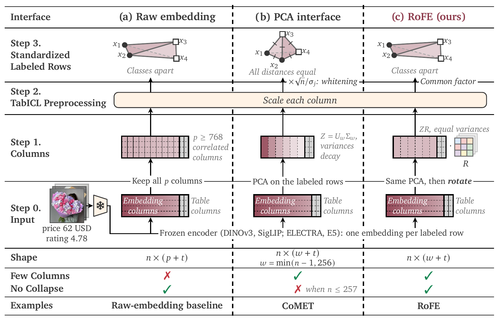

# RoFE: Rotated Frozen Embeddings for Low-Data Multimodal Tabular Learning

[Project page](https://yihao-qiao.github.io/RoFE/)

This is the implementation of RoFE and of the experiments listed in `docs/reproducing.md`. The core method is located
in `rofe/method.py`.

<p align="center"></p>

## Install

The main environment (Python 3.12) runs RoFE, CoMET, TabICLv2, the heads and the table scripts:

```bash
uv venv --python 3.12 && source .venv/bin/activate
uv pip install -e ".[test,data]"
python scripts/download_weights.py --weights weights      # TabICLv2 classifier checkpoint
```

TabPFN, MultiModalPFN, CatBoost, MulTaBench and the encoders have their own environments in `envs/`;
`docs/reproducing.md` gives the commands.

## Quick start

```python
from rofe import RoFE, make_pfn

pfn = make_pfn("tabicl", checkpoint="weights/tabicl-classifier-v2-20260212.ckpt")
model = RoFE(pfn, n_rotations=4).fit(x_labeled, y_labeled, table_labeled)  # embeddings (n, p)
proba = model.predict_proba(x_query, table_query)                         # (n_q, classes)
comet = RoFE(pfn, rotate=False).fit(x_labeled, y_labeled, table_labeled)  # the CoMET interface
```

One prepared task with ten labels per class (one GPU, a few minutes), and the tests on synthetic data (CPU):

```bash
python scripts/run.py configs/quickstart.yaml --data DATA --weights weights --out runs
pytest
```

## Data

`docs/data.md` gives the commands that clone MulTaBench, MultiModalPFN and DINOv3 at the pinned commits, prepare the
tasks in `DATA/tasks/` and extract the embeddings to `DATA/features/`. Every dataset and weight file is obtained by the
user under its own licence.

## Reproducing the tables

Each configuration in `configs/` runs one experiment, and `scripts/make_tables.py` writes the tables:

```bash
python scripts/run.py configs/<config>.yaml --data DATA --weights weights --out runs
python scripts/make_tables.py --runs runs --out tables --data DATA
```

`docs/reproducing.md` lists the configuration, output and cost of each table and figure and the staged commands of
the models in their own environments. `docs/method_to_code.md` maps the paper to the code.

## License

The code is released under the MIT License (`LICENSE`). Upstream code and model weights keep their own licences,
listed in `docs/third_party.md`.
